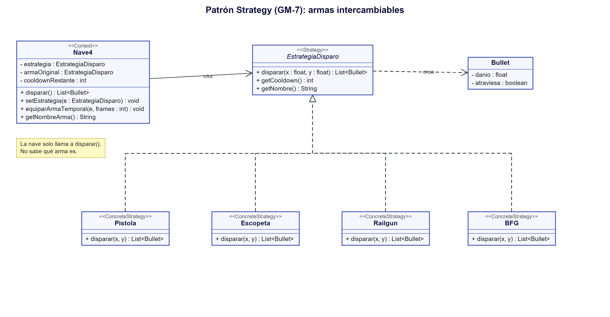
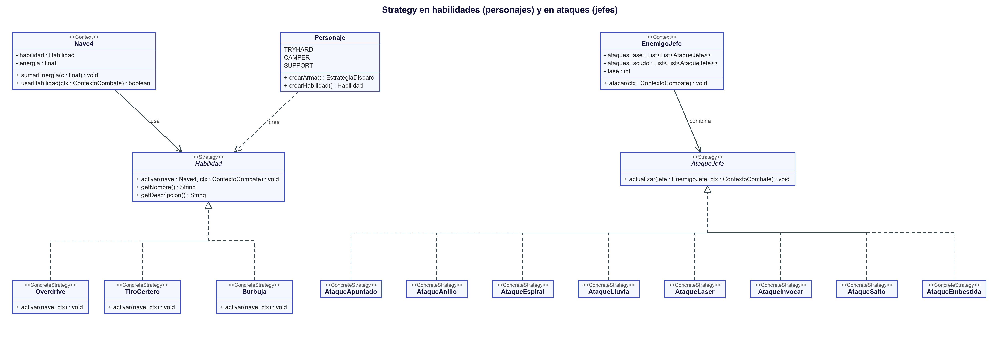

# Patrón Strategy (GM-7)

> Requerimiento GM-7: *Aplicación del patrón de diseño Strategy, describiendo problema, contexto, solución y UML.*

## Problema
En el juego base la nave disparaba siempre igual: el código que crea la bala estaba metido dentro de la clase de la nave. Nosotros queríamos varias armas distintas (pistola, escopeta, railgun, BFG...) y poder **cambiar de arma mientras se juega** (por ejemplo, al abrir una caja de botín).

Si hubiéramos dejado el código como estaba, habría que llenar `Nave4` de `if (arma == ...) { ... } else if (...)`, y cada arma nueva obligaría a modificar esa clase. Eso es difícil de leer y fácil de romper.

## Contexto
El problema aparece cuando un objeto (la nave) tiene que realizar una misma acción (disparar) pero de **distintas formas intercambiables** que pueden variar sin que el resto del programa se entere.

## Solución
Aplicamos el patrón **Strategy**: sacamos cada forma de disparar a su propia clase, y todas cumplen el mismo contrato (una interfaz). La nave guarda una referencia a la estrategia actual y solo llama a `disparar()`.

| Participante del patrón | En nuestro código |
|---|---|
| **Strategy** (interfaz) | `EstrategiaDisparo` → `modelo/armas/EstrategiaDisparo.java` |
| **ConcreteStrategy** | `Pistola`, `Escopeta`, `Railgun`, `BFG` → `modelo/armas/` |
| **Context** | `Nave4` → `modelo/Nave4.java` |

Cómo funciona en el programa:

1. `EstrategiaDisparo` define tres métodos: `disparar(x, y)` (devuelve las balas), `getCooldown()` (cuánto hay que esperar entre disparos) y `getNombre()`.
2. Cada arma implementa esos métodos a su manera:
   - **Pistola:** una bala recta, cadencia normal.
   - **Escopeta:** tres balas en abanico, cadencia lenta.
   - **Railgun:** un rayo muy rápido que **atraviesa** enemigos y hace 2 de daño.
   - **BFG 9000:** una esfera enorme y lenta que atraviesa todo y hace 5 de daño.
3. `Nave4` tiene un atributo `estrategia`. Al disparar hace `estrategia.disparar(...)`; no sabe (ni le importa) cuál arma es.
4. El arma se puede cambiar en cualquier momento con `setEstrategia(...)` (cambio permanente) o `equiparArmaTemporal(arma, fotogramas)` (la usa unos segundos y después vuelve a la del personaje).

### Dónde se cambia la estrategia (evidencia de que es intercambiable)
- `Personaje.crearArma()` (`modelo/Personaje.java`): cada personaje parte con un arma distinta (Tryhard = Pistola, Camper = Railgun, Support = Escopeta).
- `LootBox.aplicar()` (`modelo/powerups/LootBox.java`): al recoger una caja de botín se equipa un arma al azar por 15 segundos.
- `PantallaJuego.nuevaPartida()`: el modo dios (código Konami) equipa el BFG.

## UML

*(Código fuente del diagrama: `docs/uml/strategy.puml`)*

## Ventajas que notamos
- Agregar el BFG nos costó **una clase nueva** y cero cambios en `Nave4`.
- La caja de botín (`LootBox`) puede entregar cualquier arma sin saber cuál es, porque todas son una `EstrategiaDisparo`.
- `Nave4` quedó más corta y fácil de entender.

## El patrón se repite: habilidades y ataques de jefes

Como el patrón funcionó tan bien con las armas, lo usamos dos veces más (ver `docs/uml/strategy-habilidades-jefes.png`):

*(Código fuente del diagrama: `docs/uml/strategy-habilidades-jefes.puml`)*

| Contexto | Interfaz (Strategy) | Estrategias concretas | Qué decide la estrategia |
|---|---|---|---|
| `Nave4` | `Habilidad` | `Overdrive`, `TiroCertero`, `Burbuja` | Qué pasa cuando aprietas X con la barra llena |
| `EnemigoJefe` | `AtaqueJefe` | `AtaqueApuntado`, `AtaqueAnillo`, `AtaqueEspiral`, `AtaqueLluvia`, `AtaqueLaser`, `AtaqueInvocar`, `AtaqueSalto`, `AtaqueEmbestida` | Cómo ataca el jefe en cada fase |

- **Habilidades:** cada personaje del enum `Personaje` crea la suya (`crearHabilidad()`), igual que crea su arma. La nave llama a `habilidad.activar(...)` sin saber cuál es. Tryhard: Overdrive (escopeta al doble de velocidad 6 s). Camper: Tiro certero (rayo gigante). Support: Burbuja (cura, escudo y borra balas enemigas).
- **Ataques de jefes:** un jefe no es una clase enorme con un `if` por cada ataque, sino una **lista de ataques por fase** (`armarAtaques()` en `EnemigoJefe`). En cada fotograma llama a `actualizar()` de cada ataque y cada uno cuenta su propio tiempo. Para crear un jefe nuevo se combinan ataques existentes; para un ataque nuevo se crea una clase.
- **Abierto/Cerrado:** en ambos casos se agrega comportamiento nuevo con clases nuevas, sin tocar `Nave4` ni la lógica de fases del jefe.

## Requerimiento relacionado: interfaz (GM-4)
`EstrategiaDisparo` es además la **interfaz implementada por al menos 2 clases** (en realidad 4) y utilizada por la nave, con lo que también cumple la parte de interfaz de GM-4.
