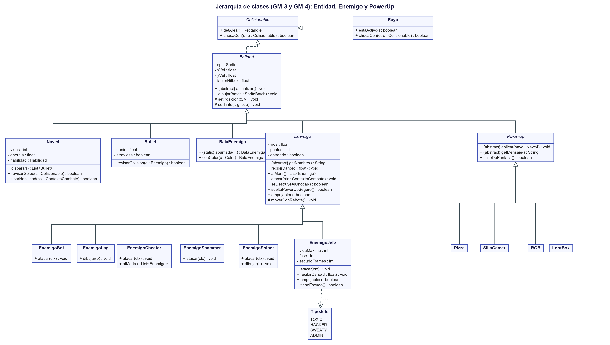

# Jerarquía de clases, clases abstractas e interfaces (GM-3 y GM-4)

> GM-3: *Diseño de diagrama UML con clases del Dominio del juego (clases base LibGDX + propias) y su código en Java.*
> GM-4: *Diseño y codificación de 1 clase abstracta que sea padre de al menos 2 clases y sea utilizada, y 1 interfaz que sea implementada por al menos 2 clases y utilizada.*

## 1. Diagrama de clases del dominio



*(Código fuente del diagrama: `docs/uml/herencia.puml`)*

Las clases base de LibGDX que usa el juego son `Game` (de la que hereda `SpaceNavigation`), `Screen` (que implementa `PantallaBase`), `Sprite`, `Texture`, `SpriteBatch`, `Sound`, `Music` y `BitmapFont`. Las clases propias están organizadas en paquetes:

| Paquete | Qué contiene |
|---|---|
| `modelo` | `Colisionable`, `Entidad`, `Nave4`, `Bullet`, `BalaEnemiga`, `Rayo`, `ContextoCombate`, `Personaje` y `Dificultad` (enums) |
| `modelo.enemigos` | `Enemigo`, `EnemigoBot`, `EnemigoLag`, `EnemigoCheater`, `EnemigoSpammer`, `EnemigoSniper`, `EnemigoJefe`, `TipoJefe` (enum) |
| `modelo.jefes` | `AtaqueJefe` (interfaz) y sus 8 ataques |
| `modelo.powerups` | `PowerUp`, `Pizza`, `SillaGamer`, `RGB`, `LootBox` |
| `modelo.armas` | `EstrategiaDisparo`, `Pistola`, `Escopeta`, `Railgun`, `BFG` |
| `modelo.habilidades` | `Habilidad` (interfaz), `Overdrive`, `TiroCertero`, `Burbuja` |
| `modelo.niveles` | `Nivel`, `NivelBuilder`, `NivelPartidaBuilder`, `DirectorNiveles` |
| `vista` | `PantallaBase` y sus 7 pantallas, `MenuBotones`, `Hud`, `BarraJefe`, `Particulas`, `Locutor`, `FondoEstrellado` |
| `util` | `GestorRecursos`, `Opciones`, `CodigoKonami` |

## 2. Clases abstractas (GM-4)

Tenemos **tres** clases abstractas, cada una padre de varias clases y todas usadas en el juego:

### `Entidad` (padre de `Nave4`, `Bullet`, `BalaEnemiga`, `Enemigo` y `PowerUp`)
Todo lo que se mueve y se dibuja en el juego tiene una imagen, una posición y una velocidad. En vez de repetir eso en cada clase, lo dejamos en `Entidad`. Es **abstracta** porque no existe una "entidad genérica": cada hija define cómo se mueve con el método abstracto `actualizar()`. También guarda el factor de hitbox y el tinte de color.
*Archivo:* `core/src/main/java/puppy/code/modelo/Entidad.java`

### `Enemigo` (padre de 6 clases)
Agrega lo que tienen en común los enemigos: la vida, los puntos, el rebote contra los bordes dentro de la zona de arriba y la **separación al chocar entre ellos** (antes se quedaban pegados). Cada tipo define su propio comportamiento:

| Hijo | Qué hace distinto |
|---|---|
| `EnemigoBot` | Avanza y rebota; desde la oleada 2 dispara una bala lenta hacia abajo |
| `EnemigoLag` | Se teletransporta (*lag spike*) y tiembla justo antes de saltar |
| `EnemigoCheater` | Grande, 3 de vida; dispara 3 balas apuntadas; al morir suelta 2 Lags |
| `EnemigoSpammer` | Flota de lado a lado y dispara ráfagas de 3 balas |
| `EnemigoSniper` | Se detiene, muestra una línea roja y dispara una bala rápida a ese punto |
| `EnemigoJefe` | Mucha vida, fases, escudo y ataques propios (ver `C6_diseno_jefes_y_dificultad.md`) |

`Enemigo` tiene **métodos gancho** con un comportamiento normal por defecto que los hijos sobrescriben: `alMorir()`, `atacar(ContextoCombate)` (por defecto no hace nada), `seDestruyeAlChocar()` (`true`), `sueltaPowerUpSeguro()` (`false`), `empujable()` (`true`) y `getColorExplosion()`. El jefe sobrescribe `atacar`, `seDestruyeAlChocar`, `sueltaPowerUpSeguro`, `empujable` y `recibirDano` (con escudo no recibe daño).
*Archivos:* `modelo/enemigos/`

### `PowerUp` (padre de `Pizza`, `SillaGamer`, `RGB` y `LootBox`)
Un power-up cae desde donde murió un enemigo y, si la nave lo toca, aplica un efecto. Lo común (caer, salir de la pantalla) está en el padre; el efecto lo define cada hija en el método abstracto `aplicar(Nave4)`.
*Archivos:* `modelo/powerups/`

## 3. Interfaces (GM-4)

- **`EstrategiaDisparo`** → implementada por **4 clases** (`Pistola`, `Escopeta`, `Railgun`, `BFG`) y utilizada por `Nave4`.
- **`Habilidad`** → implementada por **3 clases** (`Overdrive`, `TiroCertero`, `Burbuja`) y utilizada por `Nave4`.
- **`AtaqueJefe`** → implementada por **8 clases** y utilizada por `EnemigoJefe`.
- **`Colisionable`** → implementada por `Entidad` (y por lo tanto por todas sus hijas) y también por `Rayo`. Se usa como tipo del parámetro de `chocaCon(Colisionable otro)` y de `Nave4.revisarGolpe(Colisionable)`.

Las tres primeras son el patrón Strategy (ver `A2_patron_strategy.md`).

## 4. Polimorfismo (dónde se nota)

El polimorfismo es que una misma llamada se comporte distinto según el objeto. En `PantallaJuego` (`vista/PantallaJuego.java`):

```java
for (Enemigo enemigo : enemigos)
{
    enemigo.actualizar();            // el Bot rebota, el Spammer flota, el Sniper se detiene, el Jefe patrulla...
}
for (Enemigo enemigo : enemigos)
{
    enemigo.atacar(contexto);        // el Bot dispara abajo, el Cheater apunta, el Jefe usa sus ataques...
}
```

La pantalla no pregunta de qué tipo es cada enemigo: cada objeto sabe qué hacer. Lo mismo pasa con `powerUp.aplicar(nave)`, con `enemigo.alMorir()` (solo el Cheater devuelve 2 Lags) y con `nave.revisarGolpe(x)`: sirve igual para un enemigo, una bala enemiga o un rayo, porque todos son `Colisionable`.

## 5. Sobrecarga y sobreescritura (dónde están)
- **Sobreescritura:** `actualizar()`, `getNombre()`, `alMorir()`, `atacar()`, `aplicar()`, y `dibujar()` en `Nave4` (parpadeo), `EnemigoLag` (tiembla antes del salto), `EnemigoSniper` (línea de puntería) y `EnemigoJefe` (se tiñe de rojo, burbuja del escudo).
- **Sobrecarga:** el constructor de `Bullet` tiene dos versiones: una sin indicar si atraviesa (bala normal) y otra con el parámetro `atraviesa` (Railgun y BFG). `GestorRecursos.reproducirSonido()` también tiene una versión simple y otra con volumen y tono.
