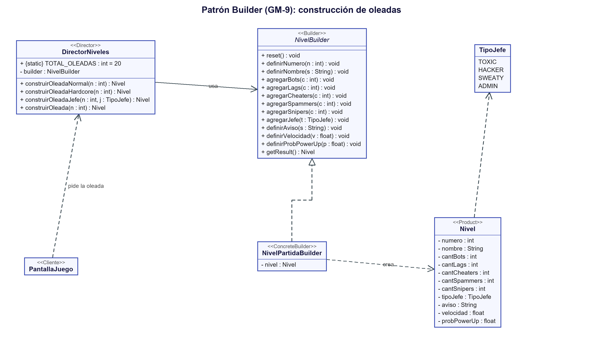

# Patrón Builder (GM-9)

> Requerimiento GM-9: *Aplicación del patrón de diseño Builder, describiendo problema, contexto, solución y UML.*

## Problema
En el juego base, para crear cada ronda se llamaba a la pantalla de juego con **siete parámetros sueltos** seguidos:

```java
new PantallaJuego(game, ronda + 1, vidas, score, velXAsteroides + 3, velYAsteroides + 3, cantAsteroides + 10);
```

Era difícil de leer (¿qué era cada número?), fácil de equivocar (cambiar el orden de dos parámetros no daba error) y casi imposible de ampliar: nosotros queríamos cinco tipos de enemigos, jefes, un aviso para el jugador, velocidad, probabilidad de power-ups y un nombre para cada oleada, lo que habría llevado el constructor a 10 o más parámetros.

## Contexto
Hay que construir un objeto **complejo, con muchas partes opcionales**, y además queremos poder armar **distintas variantes** del mismo objeto (una oleada normal, una hardcore y una de jefe) con el mismo proceso.

## Solución
Aplicamos el patrón **Builder**: separamos la *construcción* del `Nivel` de su *representación*. En vez de un constructor gigante, el nivel se arma paso a paso, y una clase "Director" conoce las recetas.

| Participante del patrón | En nuestro código |
|---|---|
| **Builder** (interfaz) | `NivelBuilder` → `modelo/niveles/NivelBuilder.java` |
| **ConcreteBuilder** | `NivelPartidaBuilder` → `modelo/niveles/NivelPartidaBuilder.java` |
| **Director** | `DirectorNiveles` → `modelo/niveles/DirectorNiveles.java` |
| **Product** | `Nivel` → `modelo/niveles/Nivel.java` |
| **Cliente** | `PantallaJuego` (pide la oleada al Director) |

Cómo funciona:

1. `NivelBuilder` declara los pasos: `definirNumero`, `definirNombre`, `agregarBots`, `agregarLags`, `agregarCheaters`, `agregarSpammers`, `agregarSnipers`, `agregarJefe`, `definirAviso`, `definirVelocidad`, `definirProbPowerUp`, `reset` y `getResult`.
2. `NivelPartidaBuilder` implementa esos pasos y guarda el `Nivel` que va armando. Los pasos que no se llaman quedan con valores por defecto (por ejemplo, sin jefe y sin power-ups).
3. `DirectorNiveles` define **tres recetas**:
   - `construirOleadaNormal(n)`: crece de a poco; cada bloque de 5 oleadas presenta enemigos nuevos (Lags desde la 2, Cheaters desde la 3, Spammers desde la 6, Snipers desde la 11).
   - `construirOleadaHardcore(n)`: más enemigos y más rápidos, pero con más probabilidad de power-ups.
   - `construirOleadaJefe(n, jefe)`: un jefe (`TipoJefe`) con pocos enemigos de apoyo.
   - `construirOleada(n)` elige la receta según el número de oleada (ver la campaña más abajo).
4. `PantallaJuego` ya no recibe 7 números: recibe un `Nivel` ya armado (`new PantallaJuego(game, nivel, nave, score, locutor)`) y lo lee con sus getters para crear los enemigos.

### La campaña de 20 oleadas

| Oleadas | Receta | Detalle |
|---|---|---|
| 1 | normal | Solo bots (aviso: cómo es el bot) |
| 2 | normal | Aparecen los Lags; los bots empiezan a disparar |
| 3 | normal | Aparecen los Cheaters |
| 4 | hardcore | Primer hardcore |
| **5** | jefe | **EL TOXIC** |
| 6 a 7 | normal | Aparecen los Spammers (aviso en la 6) |
| 8 | hardcore | |
| 9 | normal | |
| **10** | jefe | **EL HACKER** |
| 11 | normal | Aparecen los Snipers (aviso) |
| 12 | hardcore | |
| 13 a 14 | normal | |
| **15** | jefe | **EL SWEATY** |
| 16 | normal | |
| 17 | hardcore | |
| 18 | normal | |
| 19 | hardcore | Última oleada antes del final |
| **20** | jefe | **EL ADMIN** (jefe final); al derrotarlo se gana el juego |

La cantidad total (`TOTAL_OLEADAS = 20`) es una constante del Director; el HUD y el cartel de cada oleada la usan para mostrar "Oleada 5/20". Los números exactos de cada receta (cuántos enemigos, velocidad, probabilidad de power-up) están en `C6_diseno_jefes_y_dificultad.md`.

Ejemplo de uso (en `PantallaJuego.nuevaPartida()` y `revisarTransicion()`):

```java
DirectorNiveles director = new DirectorNiveles(new NivelPartidaBuilder());
Nivel siguiente = director.construirOleada(nivel.getNumero() + 1);
```

## UML



*(Código fuente del diagrama: `docs/uml/builder.puml`)*

## Ventajas que notamos
- El código que pide una oleada es de una sola línea y se entiende solo.
- Para agregar algo nuevo basta sumar un paso al Builder y usarlo en el Director. Nos pasó dos veces: con los jefes (`agregarJefe` y `definirAviso`) y con los enemigos nuevos (`agregarSpammers` y `agregarSnipers`). Pasar de 10 a 20 oleadas fue cambiar las recetas del Director; la pantalla casi no se tocó.
- El mismo `NivelBuilder` serviría para construir otro tipo de nivel creando otro ConcreteBuilder.

## Limitación
El `Nivel` tiene setters públicos porque el Builder necesita llenarlo. Una mejora futura sería hacerlo inmutable.
