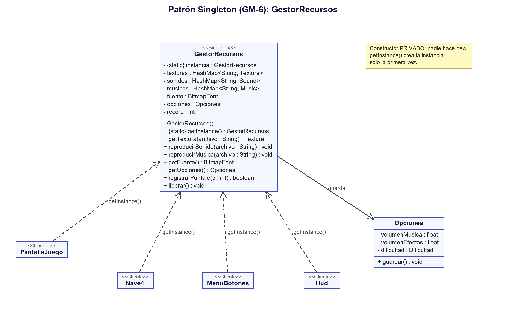

# Patrón Singleton (GM-6)

> Requerimiento GM-6: *Aplicación del patrón de diseño Singleton, describiendo problema, contexto, solución y UML.*

## Problema
En el juego base, **cada vez que empezaba una ronda** se creaba una pantalla de juego nueva, y esa pantalla volvía a cargar desde el disco las mismas imágenes y sonidos (`new Texture(...)`, `Gdx.audio.newSound(...)`). Además, cada asteroide cargaba *su propia copia* de la imagen. Esos recursos nunca se liberaban completamente:

- gastaba memoria de más (una **fuga de memoria**, que crece mientras más se juega);
- la música de fondo se reiniciaba en cada ronda;
- no había un lugar único donde guardar cosas que deben ser compartidas por todo el juego, como el **récord**.

## Contexto
Cuando existe algo que debe ser **único en todo el programa** (una sola copia de los recursos y un solo récord) y al que necesitan acceder muchas clases distintas (pantallas, nave, armas, enemigos).

## Solución
Aplicamos el patrón **Singleton** en la clase `GestorRecursos` (`core/src/main/java/puppy/code/util/GestorRecursos.java`). Se asegura de que haya **una sola instancia** en todo el programa con tres ingredientes:

1. **Constructor privado:** nadie puede hacer `new GestorRecursos()`.
   ```java
   private GestorRecursos() { ... }
   ```
2. **Atributo estático con la única instancia:**
   ```java
   private static GestorRecursos instancia;
   ```
3. **Método de acceso `getInstance()`:** la crea solo la primera vez y después siempre devuelve la misma.
   ```java
   public static GestorRecursos getInstance()
   {
       if (instancia == null)
       {
           instancia = new GestorRecursos();
       }
       return instancia;
   }
   ```

Qué guarda y ofrece el gestor:

| Método | Para qué sirve |
|---|---|
| `getTextura(archivo)` | Devuelve una imagen; si no estaba cargada, la carga y la guarda en un `HashMap`. Siguiente vez, la reutiliza. |
| `getSonido(archivo)` | Igual, para los efectos de sonido. |
| `reproducirMusica(archivo)` | Hay 3 canciones (menú, juego, jefe) pero suena **una sola**; si se pide la que ya suena no se reinicia. |
| `reproducirSonido(archivo)` | Reproduce un efecto con el volumen de efectos de las opciones. |
| `getOpciones()` | Las opciones del jugador (volúmenes y dificultad), que se guardan en `opciones.txt` con `try-catch` igual que el récord. |
| `getFuente()` | La fuente pixel-art del juego (`assets/pixel.fnt`), cargada una sola vez y compartida por todas las pantallas. |
| `getPixelBlanco()` | Un píxel blanco creado por código, que se estira para dibujar estrellas y sombras. |
| `getRecord()` / `registrarPuntaje(p)` | El récord de puntaje, guardado en el archivo `record.txt` (con manejo de excepciones con `try-catch`). |
| `liberar()` | Libera todo **una sola vez**, al cerrar el juego (lo llama `SpaceNavigation.dispose()`). |

Participantes del patrón:

| Participante | En nuestro código |
|---|---|
| **Singleton** | `GestorRecursos` |
| **Clientes** | `PantallaJuego`, `PantallaSeleccion`, `MenuBotones`, `Opciones`, `Nave4`, `Pistola`, `Escopeta`, `Railgun`, `BFG`, `EnemigoCheater`, `Hud`, `FondoEstrellado`, `SpaceNavigation`... todas piden recursos con `GestorRecursos.getInstance()` |

## UML



*(Código fuente del diagrama: `docs/uml/singleton.puml`)*

## Ventajas que notamos
- **Se acabó la fuga de memoria:** cada imagen y sonido se carga una sola vez, sin importar cuántas rondas se jueguen ni cuántos enemigos haya.
- La música ya no se reinicia en cada ronda.
- El récord vive en un solo lugar y se guarda en un archivo, así que no se pierde al cerrar el juego.
- Cualquier clase puede pedir un recurso sin que le pasemos el gestor por parámetro de pantalla en pantalla.

## Limitación (a tener en cuenta)
Un Singleton es, en el fondo, un "dato global", así que no conviene abusar de él: lo usamos solo para lo que de verdad debe ser único (recursos y récord).
