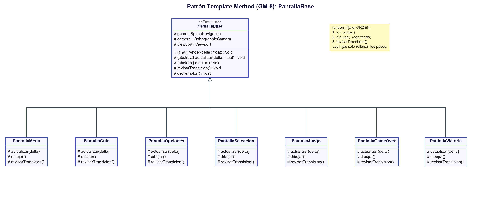

# Patrón Template Method (GM-8)

> Requerimiento GM-8: *Aplicación del patrón de diseño Template Method, describiendo problema, contexto, solución y UML.*

## Problema
En el juego base cada pantalla (menú, juego, game over) repetía el mismo código en su método `render()`: limpiar la pantalla, configurar la cámara, abrir y cerrar el `batch`, etc. Además, cada una tenía que escribir **seis métodos vacíos** (`show`, `hide`, `pause`, `resume`, `resize`, `dispose`) que casi nunca se usan.

Con el código repetido era fácil que una pantalla se olvidara de un paso (por ejemplo, de aplicar la cámara; de hecho, en el juego base la pantalla de juego creaba una cámara que **nunca llegaba a usar**).

## Contexto
Cuando varias clases siguen **la misma secuencia de pasos**, pero cada una realiza algunos de esos pasos de forma distinta.

## Solución
Aplicamos el patrón **Template Method** con la clase abstracta `PantallaBase` (`core/src/main/java/puppy/code/vista/PantallaBase.java`). Su método `render()` define el **esqueleto** del algoritmo una sola vez y es `final`, así ninguna pantalla hija puede cambiar el orden:

```java
@Override
public final void render(float delta)
{
    ScreenUtils.clear(0.02f, 0.02f, 0.1f, 1);

    actualizar(delta);                         // paso 1 (abstracto)

    viewport.apply();
    camera.update();
    game.getBatch().setProjectionMatrix(camera.combined);
    game.getBatch().begin();
    game.getFondo().dibujar(game.getBatch());  // el fondo de estrellas va siempre atrás
    dibujar();                                 // paso 2 (abstracto)
    game.getBatch().end();

    revisarTransicion();                       // paso 3 (gancho opcional)
}
```

Los pasos que cambian los dejamos para las hijas:

| Paso | Tipo | Qué hace cada pantalla |
|---|---|---|
| `actualizar(delta)` | **abstracto** (obligatorio) | La lógica: colisiones, movimiento, teclas |
| `dibujar()` | **abstracto** (obligatorio) | Dibujar lo suyo (el fondo y la cámara ya los puso la base) |
| `revisarTransicion()` | **gancho** (opcional, vacío por defecto) | Decidir si hay que cambiar de pantalla |
| `getTemblor()` | **gancho** (opcional, devuelve 0) | Cuántos píxeles tiembla la pantalla; solo `PantallaJuego` lo sobrescribe |

Participantes del patrón:

| Participante | En nuestro código |
|---|---|
| **Clase abstracta (padre)** con el *template* | `PantallaBase` |
| **Clases concretas (hijas)** que implementan los pasos | `PantallaMenu`, `PantallaGuia`, `PantallaOpciones`, `PantallaSeleccion`, `PantallaJuego`, `PantallaGameOver`, `PantallaVictoria` |

Además, `PantallaBase` deja una sola vez los 6 métodos vacíos de `Screen`, y usa un `FitViewport` con el tamaño fijo definido en `Constantes` (1200x800), de modo que **el juego se ve bien aunque se cambie el tamaño de la ventana**.

## UML



*(Código fuente del diagrama: `docs/uml/template-method.puml`)*

## Ventajas que notamos
- Cada pantalla hija quedó mucho más corta: solo escribe lo que la hace distinta.
- El orden (actualizar → dibujar → transición) está garantizado para todas.
- Agregar una pantalla nueva (como `PantallaSeleccion`, y más tarde `PantallaGuia` y `PantallaVictoria`) fue rápido: se hereda de `PantallaBase` y se rellenan los 3 pasos.
- Un cambio común a todas (como agregar el **fondo estrellado**) se hizo en un solo lugar, `PantallaBase`, y apareció en todas las pantallas.
